# TraceWeaver — Architecture

**TraceWeaver** is a visibility-aware, evidence-grounded runtime threat-detection
pipeline for containerized Linux workloads. It consumes normalized Falco/Tracee/
Tetragon events and returns an explainable, provenance-backed verdict.

## Components & data flow

```mermaid
flowchart TD
  subgraph P1[Phase 1 — Data foundation]
    RAW[("results/raw/*_events/*.jsonl<br/>(immutable sensor evidence)")]
    ADP[adapters.py<br/>Falco / Tracee / Tetragon]
    CAN[("results/normalized/events/*.jsonl<br/>canonical events v1.0.0<br/>+ raw_ref provenance")]
    IDX[("events_index.json")]
    RAW --> ADP --> CAN --> IDX
  end

  subgraph P2[Phase 2 — Detection engine]
    GRAPH[BehaviorGraph<br/>process/file/network correlation]
    A[A — anomaly 0..1]
    S[S — sequence 0..1<br/>temporal patterns]
    Pp[P — policy 0..1<br/>verified alerts/signatures]
    RISK[risk = 100·&#40;wA·A + wS·S + wP·P&#41;]
    VIS[visibility assessment]
    VERD[visibility-aware verdict]
    EXP[explanations + evidence refs]
    CAN --> GRAPH --> A & S & Pp --> RISK
    GRAPH --> VIS
    RISK --> VERD
    VIS --> VERD --> EXP
  end

  subgraph OUT[Outputs]
    ER[("results/engine/results.jsonl")]
    EV[("results/engine/evaluation.json")]
    VERD --> ER
    ER --> EVAL[evaluate.py<br/>rules-only / anomaly-only / combined] --> EV
  end

  subgraph UI[Phase 3 — Dashboard]
    TAB[/lab → TraceWeaver Engine tab/]
    ER --> TAB
    EV --> TAB
  end

  CLI[cli.py: run / validate / eligible] --> ER
```

## Module map (`scripts/traceweaver/`)

| Module | Responsibility |
|--------|----------------|
| `schema.py` | Canonical event schema v1.0.0, missing-value sentinels, redaction, validation |
| `adapters.py` | Per-sensor normalization (real formats) |
| `inventory.py` | Read-only evidence inventory (hashes, capture modes) |
| `pipeline.py` | Normalize → validate → quarantine → index (deterministic) |
| `manifest.py` | Trial-manifest contract + deterministic outcome classifier |
| `engine.py` | BehaviorGraph, A/S/P signals, risk, visibility-aware verdict, explanations |
| `engine_config.json` | Versioned weights + thresholds (wA/wS/wP sum to 1.0) |
| `run.py` | Fit baseline (train split, no leakage) + run engine over all streams |
| `evaluate.py` | Eligibility, 3 baselines, metrics with explicit denominators |
| `cli.py` | `run` / `validate` (explanation+provenance) / `eligible` |
| `validate_evidence.py` | Provenance validator (P1–P8) |

## Evidence contract (what makes this original)

- **Every** engine finding cites canonical `event_id`s and `raw_ref{file,line,sha256}`
  — a reviewer can trace any verdict back to the exact raw sensor record.
- **Visibility is a first-class dimension**, separate from detection: a risk score never
  overrides a `COLLECTION_FAILED`/`EXECUTION_FAILED`; missing events are never treated as
  evidence of absence.
- **A verified `DETECTED` requires real qualifying policy evidence (P>0)** — the engine never
  promotes a high anomaly/sequence score, a summary-derived record, or a replayed stream into a
  verified detection.

The original contribution is this **integration + evidence contract + visibility-aware verdict
layer**, not any single signal. Each signal (rule match, sequence, frequency anomaly) is standard;
fusing them under an explicit collection-quality gate with end-to-end provenance is the contribution.
