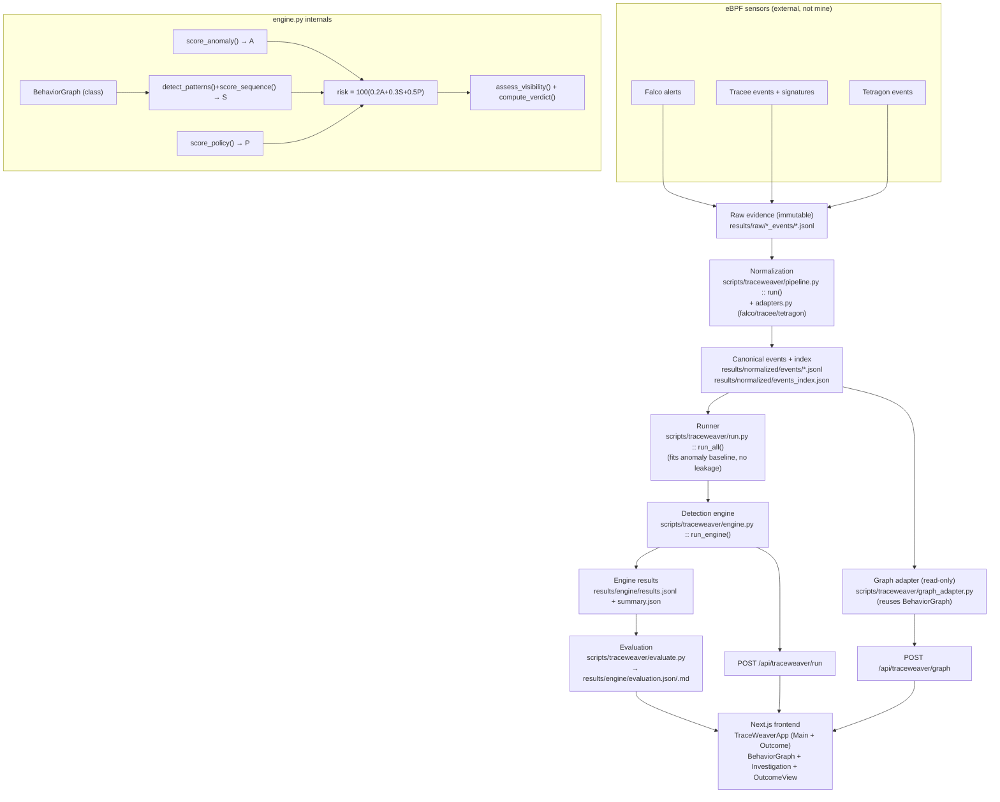

# TraceWeaver — Complete Knowledge, Code-Navigation & Viva Master Guide

> **Project:** TraceWeaver: An Explainable, Visibility-Aware Runtime Threat Detection Engine for Containerized Linux Workloads
> **Repository root:** `/home/vansh/ebpf-evasion-lab` (open with `cd ~/ebpf-evasion-lab`)
> **Purpose of this document:** a single, self-contained teaching file. Everything below was verified by reading the actual files in the repository on 2026‑10‑27. Exact paths, symbol names, line numbers, weights, thresholds, metrics and test counts are taken from the current code, not from memory or the README.
>
> **How to read the status tags used throughout:**
> - **[VERIFIED]** — read directly from the current source / ran successfully.
> - **[PARTIAL]** — implemented but with a documented limitation.
> - **[NOT LIVE]** — works on recorded evidence only; not a fresh live capture.

---

## Table of Contents
1. [Project Overview](#1-project-overview)
2. [Complete Architecture](#2-complete-architecture)
3. [Filesystem Map (navigation)](#3-filesystem-map--highest-priority)
4. [If the Faculty Asks Me to Show the Code](#4-if-the-faculty-asks-me-to-show-the-code)
5. [Sensors & Ingestion](#5-sensors--ingestion)
6. [Canonical Schema & Normalization](#6-canonical-schema--normalization)
7. [Exact Detection Algorithm](#7-exact-detection-algorithm)
8. [Event Correlation & Behavior Graph](#8-event-correlation--behavior-graph)
9. [Frontend Walkthrough](#9-frontend-walkthrough)
10. [Backend & API](#10-backend--api)
11. [Test Cases & Evaluation](#11-test-cases--evaluation)
12. [Novelty & Limitations](#12-novelty--limitations)
13. [Viva Preparation](#13-viva-preparation)
14. [Demonstration & Terminal Commands](#14-demonstration--terminal-commands)
15. [Code Navigation Quick Reference](#15-code-navigation-quick-reference)
16. [Verified Implementation Status](#16-verified-implementation-status)

---

## 1. Project Overview

### One-sentence definition
TraceWeaver turns raw runtime-security sensor output (Falco, Tracee, Tetragon) into **explainable, visibility-aware verdicts**, where every verdict, score, graph node and edge traces back to an exact raw evidence record (`file:line:sha256`).

### The problem it addresses
Runtime sensors emit huge volumes of raw events, but **a raw event is not a verdict**. Teams routinely conflate three different things:
- **Telemetry** — the kernel/sensor *saw* a syscall.
- **Detection** — a rule/signature actually *classified* something as a threat.
- **Collection quality** — did the sensor even *capture* usable data?

When these are confused, missing events get read as "nothing happened" (false safety) and noisy anomaly scores get read as "attack" (false alarms). TraceWeaver keeps these three concepts explicitly separate.

### Why it matters
Containerized Linux workloads are a huge attack surface. A security team needs to know not just "did an alert fire" but "what behaviour happened, is the evidence trustworthy, and can I prove it". TraceWeaver is built around that evidence-first discipline.

### What I actually built
- A **canonical event schema** + deterministic **normalizer** that converts three different sensor formats into one shape.
- A **detection engine** that builds a behaviour graph and computes three signals — **A**nomaly, **S**equence, **P**olicy — into a risk score and a **visibility-aware verdict**.
- An **evaluation harness** comparing rules-only vs anomaly-only vs the combined engine on a labelled set with held-out benign controls.
- A **two-tab web product** (Main + Outcome) with an **interactive behaviour graph + progressive replay**, event timeline, and evidence inspector.
- **Tests + validators** that make invalid evidence un-promotable (no finding may cite a non-existent event; no `DETECTED` without real policy evidence).

### What Falco, Tracee, Tetragon contribute (and what is *not* mine)
These three are **existing open-source eBPF sensors** — I did **not** write them. They provide the raw telemetry/alerts. **[VERIFIED]** by the raw evidence in `results/raw/`.
- **Falco** — rule-based alerting engine (emits alerts/notices).
- **Tracee** — events + behavioural *signatures* (e.g. `sudoers_modification`).
- **Tetragon** — eBPF tracing with policy matches.

### What TraceWeaver adds beyond those tools
The **integration** is the contribution, not the individual signals:
1. A **unified canonical schema** across all three sensors with explicit missing-value handling.
2. A **visibility-aware verdict layer** where a high risk score *never* overrides a collection/execution failure.
3. An **end-to-end evidence contract** — every finding → `event_id` → `file:line:sha256`, enforced by validators and tests.
4. An **explainable behaviour graph + replay** built from the same correlation the detector uses.

### What happens from opening the app to a verdict
1. Open `http://localhost:3000/` → **Main** tab (Scenario Explorer).
2. Pick an evidence stream → a live graph preview loads.
3. Click **Run Analysis** → the backend runs the real Python engine on that stream.
4. The app switches to **Outcome** → behaviour graph + replay, verdict, risk, A/S/P signals, timeline, visibility panel, and the evaluation comparison.

### Working vs incomplete
- **Working [VERIFIED]:** normalization, engine, verdicts, graph + replay, Scenario Explorer, evaluation, tests, both API endpoints.
- **Limitation [PARTIAL]:** Tetragon live container capture is broken post-reboot (classified `COLLECTION_FAILED`); Falco/Tracee unaffected.
- **Operating mode [NOT LIVE]:** the app runs over **recorded historical evidence** (`results/raw/*`). "Run Analysis" runs the engine live *on demand*, but the sensor events are replayed, not freshly captured. The UI labels this **Historical Replay** everywhere.

### Spoken explanations
- **30 seconds:** "TraceWeaver turns raw Falco, Tracee and Tetragon output into explainable, visibility-aware verdicts. It separates telemetry from detection from collection failures, correlates events into a behaviour graph, scores three signals into a risk number, and makes every verdict traceable to the exact raw log line."
- **1 minute:** add — "Raw events from three sensors are normalized into one canonical schema. The engine builds a behaviour graph, then computes three signals: anomaly (A), suspicious sequence (S), and verified policy evidence (P). Risk = 100 × (0.2·A + 0.3·S + 0.5·P). A visibility layer sits on top — if collection failed, no score can call it a detection, and missing data is never read as safe. On a labelled set the combined engine reaches F1 0.97 with zero false positives on the benign control, versus 0.61 for rules-only."
- **3 minutes:** walk the pipeline (sensors → normalize → graph → A/S/P → risk → verdict → evidence), show a real `DETECTED` (Tracee sudoers) citing its source line, contrast a `COLLECTION_FAILED` Tetragon stream, then show the behaviour-graph replay and the evaluation table. Stress: deterministic, auditable, no ML black-box, every number traces to raw evidence.

---

## 2. Complete Architecture

### Data flow (actual implementation)



### Component responsibility table **[VERIFIED]**

| Component | File | Main symbol | Inputs | Outputs | Called by | Consumes output | Error handling | Status |
|---|---|---|---|---|---|---|---|---|
| Canonical schema | `scripts/traceweaver/schema.py` | `build_event()` :120, `validate_event()` :137, `FIELDS` :55 | sensor fields | canonical event dict | adapters, pipeline | engine, graph adapter | `validate_event` returns error list; bad events quarantined | VERIFIED |
| Adapters | `scripts/traceweaver/adapters.py` | `falco_adapter()` :44, `tracee_adapter()` :105, `tetragon_adapter()` :180 | one raw JSON record | canonical event | `pipeline.run()` | — | raises `AdapterQuarantine` | VERIFIED |
| Normalizer | `scripts/traceweaver/pipeline.py` | `run()` :58 | `results/raw/*` | `results/normalized/events/*` + `events_index.json` + `quarantine.jsonl` | CLI / demo | runner, graph adapter | JSON parse errors + schema failures → quarantine | VERIFIED |
| Behavior graph | `scripts/traceweaver/engine.py` | `class BehaviorGraph` :48 (`_build` :79) | canonical events | nodes dict + edges list | `run_engine`, graph adapter | detect_patterns, graph adapter | unknown identities kept explicit | VERIFIED |
| Anomaly signal | `scripts/traceweaver/engine.py` | `score_anomaly()` :142 | events + baseline | A∈[0,1] + reasons | `run_engine` | risk | empty events → 0.0 | VERIFIED |
| Sequence signal | `scripts/traceweaver/engine.py` | `detect_patterns()` :183, `score_sequence()` :252 | events + graph | findings + S∈[0,1] | `run_engine` | risk, verdict | patterns require specific types/fields | VERIFIED |
| Policy signal | `scripts/traceweaver/engine.py` | `score_policy()` :262 | events | P∈{0,1} + qualifying events | `run_engine` | risk, verdict | custom Falco rule excluded | VERIFIED |
| Risk + verdict | `scripts/traceweaver/engine.py` | `run_engine()` :327, `compute_verdict()` :299, `assess_visibility()` :280 | A,S,P,visibility | verdict + risk + result dict | `run_all` | results, API, UI | visibility precedes score | VERIFIED |
| Runner / baseline | `scripts/traceweaver/run.py` | `run_all()` :74, `fit_baseline()` :62 | index | results list | CLI, evaluate | engine, evaluate | baseline streams excluded from metrics | VERIFIED |
| Evaluation | `scripts/traceweaver/evaluate.py` | `evaluate()` :128, `predict()` :73, `metrics()` :109 | engine results | `evaluation.json/.md` | CLI | UI | zero-denominator → `None` (N/A) | VERIFIED |
| Graph adapter | `scripts/traceweaver/graph_adapter.py` | `build_graph_payload()` :63 | one stream path | nodes/edges/events + nested engine result | `cli graph` / graph API | frontend graph | unknown stream → `{ok:false}` | VERIFIED |
| CLI | `scripts/traceweaver/cli.py` | `main()` :138 (`cmd_run` :79, `cmd_graph` :111, `cmd_validate` :98) | argv | JSON / report | demo, API | — | exit codes 0/1/2/3 | VERIFIED |
| Provenance validator | `scripts/traceweaver/cli.py` | `validate_results()` :26 | results | problem list | `cmd_validate` | — | lists violations, exit 1 | VERIFIED |
| API: run | `dashboard/app/api/traceweaver/run/route.ts` | `POST` | `{stream}` | `{ok, result}` | frontend | OutcomeView | allowlist + traversal guard + 60s timeout | VERIFIED |
| API: graph | `dashboard/app/api/traceweaver/graph/route.ts` | `POST` | `{stream}` | graph payload | frontend | Investigation/Outcome | same guards | VERIFIED |
| Frontend shell | `dashboard/components/TraceWeaverApp.tsx` | `TraceWeaverApp()` :78 | `DashboardData` | the two-tab UI | `app/page.tsx` | user | fetch errors shown inline; race-guarded | VERIFIED |

### One real trial traced end to end **[VERIFIED by running the engine]**
Trial **`A6_tracee_t1`** (Tracee, sudoers modification):
1. Raw: `results/raw/tracee_events/A6_tracee_t1.jsonl` line 8 has `eventName: "sudoers_modification"`.
2. Normalized: `results/normalized/events/tracee__A6_tracee_t1.jsonl` → a `security_alert` event `ev_bb1d8efbf63e8779844d`, `raw_ref {file:…A6_tracee_t1.jsonl, line:8, sha256:3c002c…}`.
3. Engine: `score_policy` finds a qualifying signature → **P = 1.0**; `detect_patterns` fires `sudoers_modification` severity 0.75 → **S = 0.75**; **A = 0.0**.
4. Risk = `100 × (0.2·0 + 0.3·0.75 + 0.5·1.0)` = **72.5** → band **HIGH**.
5. Visibility = `FULL`, P>0 → verdict **DETECTED**, citing the signature event at source line 8.

Command to reproduce: `python3 -m scripts.traceweaver.cli run --stream results/raw/tracee_events/A6_tracee_t1.jsonl --no-write`

---

## 3. Filesystem Map — HIGHEST PRIORITY

### Concise tree (only real, important paths)

```
~/ebpf-evasion-lab/
├── scripts/
│   ├── traceweaver/                     ← TraceWeaver Python package
│   │   ├── schema.py                    canonical schema, sentinels, build/validate event
│   │   ├── adapters.py                  falco/tracee/tetragon → canonical
│   │   ├── pipeline.py                  normalization driver (raw → canonical + index)
│   │   ├── engine.py                    DETECTION ENGINE (graph, A/S/P, risk, verdict)
│   │   ├── engine_config.json           weights + thresholds + anomaly lists
│   │   ├── run.py                       runner + anomaly-baseline fit (no leakage)
│   │   ├── evaluate.py                  rules/anomaly/combined metrics
│   │   ├── graph_adapter.py             read-only behaviour-graph payload builder
│   │   ├── cli.py                       CLI entry (run / graph / validate / eligible)
│   │   ├── inventory.py                 evidence inventory helper
│   │   └── validate_evidence.py         P1–P8 provenance/determinism checks
│   ├── normalize.py                     (OTHER study's normalizer — not TraceWeaver)
│   ├── traceweaver_demo.sh              one-command 8-step demo
│   └── traceweaver_pipeline.sh          pipeline wrapper
├── results/
│   ├── raw/                             IMMUTABLE recorded sensor evidence
│   │   ├── falco_events/*.jsonl         43 streams
│   │   ├── tracee_events/*.jsonl        43 streams
│   │   └── tetragon_events/*.jsonl      25 streams
│   ├── normalized/
│   │   ├── events/*.jsonl               canonical events (per stream)
│   │   ├── events_index.json            stream index (111 streams, 2068 events)
│   │   └── quarantine.jsonl             rejected records (currently 0)
│   └── engine/
│       ├── results.jsonl                engine output (one JSON per stream)
│       ├── summary.json                 verdict/visibility/sensor distributions
│       ├── evaluation.json              rules/anomaly/combined metrics
│       └── evaluation.md                human-readable metrics (auto-generated)
├── tests/
│   ├── test_engine.py                   26 engine regression tests
│   ├── test_traceweaver.py              17 schema/adapter/pipeline tests
│   └── test_graph_adapter.py            8 graph-adapter tests
├── dashboard/                           Next.js 15 + React 19 + Tailwind frontend
│   ├── app/
│   │   ├── page.tsx                     "/" → renders TraceWeaverApp
│   │   ├── layout.tsx                   wraps everything in AppShell
│   │   └── api/traceweaver/
│   │       ├── run/route.ts             POST /api/traceweaver/run
│   │       └── graph/route.ts           POST /api/traceweaver/graph
│   ├── components/
│   │   ├── TraceWeaverApp.tsx           two-tab shell (Main + Outcome)
│   │   ├── AppShell.tsx                 chrome; passthrough for "/" and "/demo"
│   │   └── traceweaver/
│   │       ├── OutcomeView.tsx          verdict, risk gauge, signals, evaluation
│   │       ├── Investigation.tsx        graph+replay orchestrator + timeline + inspector
│   │       └── BehaviorGraph.tsx        SVG graph renderer (zoom/pan/select)
│   └── lib/
│       ├── data.ts                      server-side loaders (fs) + REPO_ROOT
│       ├── types.ts                     TypeScript types (incl. GraphPayload)
│       └── graphLayout.ts               deterministic force layout (no deps)
├── docs/                                architecture/algorithm/evaluation docs
└── README.md
```

### Key-file reference tables

**Detection core (Python)**

| File path | Purpose | Important symbols | When faculty may ask |
|---|---|---|---|
| `scripts/traceweaver/engine.py` | The detection engine: graph, A/S/P, risk, verdict | `BehaviorGraph`:48, `score_anomaly`:142, `detect_patterns`:183, `score_sequence`:252, `score_policy`:262, `assess_visibility`:280, `compute_verdict`:299, `risk_band`:316, `run_engine`:327 | "show your algorithm / risk formula / verdict logic" |
| `scripts/traceweaver/engine_config.json` | Weights, thresholds, anomaly lists | `risk_weights` (wA 0.2 / wS 0.3 / wP 0.5), `thresholds` (risk_suspicious 40, risk_high 70) | "where do the weights come from" |
| `scripts/traceweaver/schema.py` | Canonical schema + provenance | `FIELDS`:55, `MISSING_SENTINELS`:34, `build_event`:120, `validate_event`:137, `_stable_event_id`:113 | "where is your schema / how are IDs made" |
| `scripts/traceweaver/adapters.py` | Sensor-specific mapping | `falco_adapter`:44, `tracee_adapter`:105, `tetragon_adapter`:180 | "how do you parse each sensor" |
| `scripts/traceweaver/pipeline.py` | Normalization driver | `run`:58 | "where do you normalize events" |
| `scripts/traceweaver/run.py` | Runner + baseline fit | `run_all`:74, `fit_baseline`:62, `BASELINE_STREAM_PREFIXES`:27 | "how do you avoid data leakage" |
| `scripts/traceweaver/evaluate.py` | Metrics | `predict`:73, `confusion`:85, `metrics`:109, `eligibility`:53, `LABELS`:36 | "show your results / methodology" |
| `scripts/traceweaver/graph_adapter.py` | Graph payload | `build_graph_payload`:63 | "where is the graph built" |
| `scripts/traceweaver/cli.py` | CLI + provenance validator | `main`:138, `cmd_graph`:111, `validate_results`:26 | "how do you prove a detection" |

**Frontend (TypeScript/React)**

| File path | Purpose | Important symbols | When faculty may ask |
|---|---|---|---|
| `dashboard/components/TraceWeaverApp.tsx` | Two-tab shell + Scenario Explorer + Run Analysis | `TraceWeaverApp`:78, `categoryFor`, `fetchGraph`, `PreviewGraph`:486 | "show the frontend / the two tabs" |
| `dashboard/components/traceweaver/OutcomeView.tsx` | Verdict + risk + signals + evaluation | `OutcomeView`:326, `RiskGauge`:89, `SignalBar`:124, `EvaluationView`:245 | "how does the frontend display the result" |
| `dashboard/components/traceweaver/Investigation.tsx` | Graph + replay + timeline + inspector | `Investigation`:255, `EventTimeline`:27, `Detail`:92 | "how does the replay work" |
| `dashboard/components/traceweaver/BehaviorGraph.tsx` | SVG graph renderer | `BehaviorGraph`:47, `NodeShape`:22 | "show the graph component" |
| `dashboard/lib/graphLayout.ts` | Deterministic layout | `computeLayout`:18 | "what graph library did you use" (answer: none — custom SVG) |
| `dashboard/lib/data.ts` | Server loaders | `REPO_ROOT`:28, `loadEngineResults`:82, `isSafeEvidencePath`:93 | "how does data reach the UI" |
| `dashboard/app/api/traceweaver/run/route.ts` | Engine API | `POST`, `allowedStreams()` | "show the backend API" |
| `dashboard/app/api/traceweaver/graph/route.ts` | Graph API | `POST` | "how does graph data reach the frontend" |

### How to open any file (Kali terminal)
```bash
cd ~/ebpf-evasion-lab
sed -n '1,180p' scripts/traceweaver/engine.py      # view first 180 lines
grep -n 'def run_engine' scripts/traceweaver/engine.py   # jump to a function
less scripts/traceweaver/engine.py                 # scroll (q to quit)
```
If an editor is installed you may use `code <file>` (VS Code) or `nano <file>` — but the `sed`/`grep` commands above work everywhere and are what this guide uses.

---

## 4. If the Faculty Asks Me to Show the Code

For each: **open → point → say → follow-up**.

### "Show me your algorithm."
- **Open:** `sed -n '142,275p' scripts/traceweaver/engine.py`
- **Point at:** `score_anomaly` (142), `detect_patterns` (183), `score_sequence` (252), `score_policy` (262).
- **Say:** "Three independent signals. Anomaly is the share of suspicious actions vs a baseline; sequence is the max severity of temporal patterns like a sudoers edit; policy is 1 only when a real sensor rule/signature fired. They're deterministic rules and simple frequency stats — no black-box ML."
- **Follow-up file:** `engine_config.json` (weights) or `run_engine` (327, how they combine).

### "Where is the risk formula?"
- **Open:** `grep -n 'risk = round' scripts/traceweaver/engine.py` → line 336.
- **Point at:** `risk = round(100 * (w["wA"]*A + w["wS"]*S_sig + w["wP"]*P), 2)` and `engine_config.json` lines 7–9.
- **Say:** "Risk = 100 × (0.2·A + 0.3·S + 0.5·P). Weights live in config, they sum to 1, and policy is weighted highest because it's the most evidence-grounded signal."
- **Follow-up:** `risk_band` (316) for the LOW/SUSPICIOUS/HIGH bands (40 / 70).

### "Explain the architecture."
- **Open:** `sed -n '327,386p' scripts/traceweaver/engine.py` (the `run_engine` orchestration).
- **Say:** "One function wires it: build the graph, score A/S/P, compute risk, assess visibility, then compute the verdict. The runner feeds it; the API and frontend consume it."
- **Follow-up:** the Mermaid diagram in §2, or `run.py :: run_all` (74).

### "Where do you normalize events?"
- **Open:** `sed -n '58,130p' scripts/traceweaver/pipeline.py`, then `sed -n '55,99p' scripts/traceweaver/schema.py`.
- **Point at:** `pipeline.run()` loop calling `adapter(rec, ctx)` then `S.validate_event(ev)`; `FIELDS` list in schema.
- **Say:** "Each raw line goes through a sensor adapter into the canonical `FIELDS` shape, is schema-validated, and gets a deterministic `event_id` and a `raw_ref` back to its source line + file hash. Invalid records are quarantined, not dropped silently."
- **Follow-up:** `adapters.py` for the per-sensor mapping.

### "How do you correlate events?"
- **Open:** `sed -n '48,120p' scripts/traceweaver/engine.py` (`BehaviorGraph`).
- **Point at:** `_proc_key` (61 — uses `container_id` + `pid`), `_build` (79 — `parent_of`, `accessed`, `connected` edges).
- **Say:** "Nodes are processes/files/containers/endpoints keyed by concrete identity. Edges are only created from real fields — parent/child from pid+parent_pid, file access from file ops. If identity is missing I keep the node explicit and do **not** invent an edge."
- **Follow-up:** `graph_adapter.py` for how this becomes the UI graph.

### "Where is the graph built?"
- **Say:** "Both sides, but one source of truth. The **backend** `BehaviorGraph` (engine.py:48) is the real correlation. `graph_adapter.py` (63) serializes those same nodes/edges plus ordered events; the **frontend** only lays them out and renders them (`graphLayout.ts`, `BehaviorGraph.tsx`). The frontend never invents relationships."

### "How does the graph replay work?"
- **Open:** `sed -n '255,340p' dashboard/components/traceweaver/Investigation.tsx`.
- **Point at:** `reveal` state, the `useEffect` playback loop, `play/pause/step/resetReplay/complete`, `pickEvent`.
- **Say:** "Events are already ordered by timestamp. `reveal` is how many events are shown; a node appears at its first event, an edge at its supporting event. Play advances `reveal` on a timer; Step advances one; the scrubber sets it directly. It's playback of recorded evidence — labelled Historical Replay — not live monitoring."
- **Follow-up:** `BehaviorGraph.tsx` for the reveal filtering (`visibleNodeIds`).

### "Where is the verdict decided?"
- **Open:** `sed -n '280,326p' scripts/traceweaver/engine.py`.
- **Point at:** `assess_visibility` (280) then `compute_verdict` (299).
- **Say:** "Visibility is assessed first. The verdict has strict precedence: execution/collection failure beats everything, then P>0 is DETECTED, then suspicious telemetry, then NOT_DETECTED only under full visibility. A high risk score can never override a failure."

### "How do you prove a detection?"
- **Open:** `grep -n 'raw_ref' scripts/traceweaver/schema.py` and `sed -n '26,58p' scripts/traceweaver/cli.py` (`validate_results`).
- **Say:** "Every event carries `raw_ref = {file, line, sha256}`. Every finding lists the `event_ids` it's built from. The validator proves no finding cites a non-existent event and no DETECTED exists without policy evidence."
- **Follow-up:** run `python3 -m scripts.traceweaver.cli validate`.

### "Show me the backend API."
- **Open:** `sed -n '29,63p' dashboard/app/api/traceweaver/run/route.ts`.
- **Point at:** `allowedStreams()` (allowlist from `events_index.json`), the traversal guard, `execFile("python3", ["-m","scripts.traceweaver.cli","run","--stream",stream,...])`.
- **Say:** "Run Analysis POSTs a stream path. The route validates it against an allowlist, rejects traversal, then runs the real Python engine with a bounded timeout and returns its JSON. No shell, no arbitrary paths."

### "How does the frontend display the result?"
- **Open:** `sed -n '326,469p' dashboard/components/traceweaver/OutcomeView.tsx`.
- **Say:** "The API returns the engine result; `OutcomeView` renders the verdict card, a risk gauge, the A/S/P breakdown using the real weights, the findings with provenance, and the evaluation table. The graph+replay is `Investigation`."

### "Show me your results."
- **Open:** `python3 -m json.tool results/engine/evaluation.json | less`, or `cat results/engine/evaluation.md`.
- **Say:** "Rules-only F1 0.61, anomaly-only 0.84, combined 0.97, with zero false positives on the benign control. 52 eligible trials, benign control held out as the negative class."

### "Where are your test cases?"
- **Open:** `ls results/raw/*/` (recorded evidence), `sed -n '1,40p' tests/test_engine.py`, `tests/test_graph_adapter.py`.
- **Say:** "Test cases are the 111 recorded sensor streams plus 51 automated tests across three files. Validators prove provenance integrity."

### "What happens when collection fails?"
- **Open:** `sed -n '280,316p' scripts/traceweaver/engine.py` (`assess_visibility` + `compute_verdict`).
- **Say:** "If the manifest says collection failed, visibility is COLLECTION_FAILED and the verdict is COLLECTION_FAILED regardless of any score. In the UI it renders a distinct failure card, never an empty graph read as 'clean'." Demo stream: `results/raw/tetragon_events/E04.jsonl`.

### "Is the system live?"
- **Say honestly:** "No fresh live capture in the current demo — it runs over recorded evidence. The `capture_*.sh` scripts exist to re-capture, and the stored `capture_mode` is 'live' meaning the data was originally captured live, but the app **replays** it. The engine computation *is* run live on demand when you click Run Analysis. The UI labels everything Historical Replay."
- **Open (evidence):** `grep -n 'Historical Replay' dashboard/components/traceweaver/Investigation.tsx`; `ls scripts/capture_*.sh`.

---

## 5. Sensors & Ingestion

| Sensor | What it provides | Stored evidence | Format | How it enters TraceWeaver | Live capture now? |
|---|---|---|---|---|---|
| **Falco** | Rule-based alerts | `results/raw/falco_events/*.jsonl` (43) | JSON per alert (`rule`, `output_fields`, `output`, `priority`) | `falco_adapter` → `security_alert` | Script exists; app replays [NOT LIVE] |
| **Tracee** | Events + behavioural signatures | `results/raw/tracee_events/*.jsonl` (43) | JSON per event (`eventName`, `args`, pids, `cgroupId`) | `tracee_adapter` | Script exists; app replays [NOT LIVE] |
| **Tetragon** | eBPF process/file tracing | `results/raw/tetragon_events/*.jsonl` (25) | JSON per event | `tetragon_adapter` | **Broken** post-reboot → COLLECTION_FAILED [PARTIAL] |

**Fields that survive normalization:** `event_id`, `timestamp`, `canonical_type`, `sensor`, `sensor_native_event`, `process_name`, `process_args` (redacted), `pid`, `parent_pid`, `container_id`, `container_name`, `file_path`, `network_dest`, `raw_ref`. Fields a sensor doesn't supply become explicit sentinels (e.g. Falco alerts have no `pid` → `<NOT_SUPPLIED>`).

**Known parsing limitations:** Falco alerts don't carry pid/parent_pid, so lineage edges can't be built from Falco alone (surfaced in the UI "why correlation is limited" panel). Totals **[VERIFIED]**: 111 streams, **2068** events, **0** quarantined, all `capture_mode = live`.

---

## 6. Canonical Schema & Normalization

### The schema (`scripts/traceweaver/schema.py`)
- **`SCHEMA_VERSION = "1.0.0"`** (line 22).
- **`FIELDS`** (line 55) — the ordered canonical record: `schema_version, event_id, trial_id, scenario_id, sensor, sensor_version, policy_mode, capture_mode, timestamp, timestamp_source, container_id, container_name, pid, parent_pid, process_name, process_args, canonical_type, file_path, file_operation, network_dest, network_port, sensor_native_event, raw_ref, collection_status, normalization_warnings`.
- **`CANONICAL_TYPES`** (line 37): `process_exec, process_exit, file_open, file_write, network_connect, security_alert, other`.
- **Missing-value sentinels** (line 30–34): `<NOT_SUPPLIED>`, `<UNPARSEABLE>`, `<NOT_APPLICABLE>`, `<UNKNOWN_COLLECTION>` — strings so they survive JSON and are never confused with real values.
- **Event IDs** — `_stable_event_id` (line 113): `"ev_" + sha256(sensor|trial_id|raw_file|raw_line|native_event|timestamp)[:20]`. Deterministic and reproducible.
- **Provenance** — every event has `raw_ref = {file, line, sha256}` pointing at the exact source line and the file's hash.
- **Validation** — `validate_event` (line 137) returns a list of violations; `REQUIRED_CONCRETE` fields may never be a sentinel.
- **Redaction** — `redact` (line 100) strips likely secrets (passwords, tokens, AWS keys, JWTs) from copied arg strings.
- **Determinism** — events serialized with `sort_keys=True`; the pipeline is idempotent.

### Real example (Tracee sudoers) **[VERIFIED]**
Raw (`results/raw/tracee_events/A6_tracee_t1.jsonl:8`): `eventName: "sudoers_modification"` with nested `args`.
Normalized (`results/normalized/events/tracee__A6_tracee_t1.jsonl`):
```json
{
  "event_id": "ev_bb1d8efbf63e8779844d",
  "canonical_type": "security_alert",
  "sensor": "tracee",
  "sensor_native_event": "sudoers_modification",
  "process_name": "sh",
  "container_id": "5247ad4a8ef1a7467b6588527475f73d772fb839fa7894a20970364bccbd0f87",
  "file_path": "<NOT_APPLICABLE>",
  "timestamp": "2026-10-16T06:51:06.932777+00:00",
  "raw_ref": { "file": "results/raw/tracee_events/A6_tracee_t1.jsonl", "line": 8,
               "sha256": "3c002cecbb209991e82900a0edb5030aa501005714a014179bd080c9e62a4b1a" }
}
```
`file_path` is `<NOT_APPLICABLE>` because this signature is reported as an alert, not a file event — an honest sentinel rather than a guess.

> **Note:** there is also a top-level `scripts/normalize.py`. That belongs to the *earlier* eBPF detection **study** (produces `results/normalized/results.json`), **not** TraceWeaver. TraceWeaver's normalizer is `scripts/traceweaver/pipeline.py`.

---

## 7. Exact Detection Algorithm

### A. Anomaly signal — `score_anomaly()` (engine.py:142) **[VERIFIED]**
- **Method:** deterministic rule + frequency check (NOT machine learning).
- **An event is anomalous if:** its `file_path` is in `sensitive_paths` (`/etc/shadow`, `/etc/sudoers`, `/etc/ssh/ssh_host_rsa_key`, `/etc/gshadow`), **or** a `process_exec` arg contains a `suspicious_exec_dir` (`/tmp/`, `/dev/shm/`, `/var/tmp/`).
- **A novel process name alone is *context only*** — it does not raise A (prevents flagging benign `echo`/`ls` on a small baseline).
- **Score:** `A = min(1.0, anomalous_count / max(1, total_events) × 3.0)`, rounded to 4 dp.
- **Missing events → A = 0.0** (absence is never anomalous).

### B. Suspicious-sequence signal — `detect_patterns()` (183) + `score_sequence()` (252) **[VERIFIED]**
Patterns require specific canonical types + fields (not a mere filename substring), isolated to one stream:

| Pattern | Severity | Trigger | MITRE |
|---|---:|---|---|
| `sensitive_file_access` | 0.80 | file op on a sensitive path | T1552.001, T1555 |
| `sudoers_modification` | 0.75 | file op on `/etc/sudoers*` | T1548.003 |
| `exec_from_suspicious_dir` | 0.70 | exec arg in a temp/world-writable dir | T1204, T1059 |
| `nested_shell_execution` | 0.45 (chained) / 0.30 | ≥2 shell execs; 0.45 only if a `parent_of` edge links them | T1059.004 |
| `discovery_sequence` | 0.40 | ≥3 distinct discovery tools (`id,uname,hostname,whoami,ps,cat`) | T1082, T1033 |

**S = max severity among triggered patterns** (0 if none). When relationships can't be established (e.g. no `parent_of` edge), the weaker 0.30 severity is used and the explanation says so.

### C. Policy-evidence signal — `score_policy()` (262) **[VERIFIED]**
- **P = 1.0 iff** a `security_alert` event exists whose `sensor_native_event` is **not** the lab's custom telemetry rule `FALCO_CUSTOM_RULE = "EBPF Lab Container Process Execution"` (engine.py:28).
- Qualifying = Falco built-in rule or Tracee behavioural signature. The custom process-exec notice is **telemetry-grade, not a detection**.
- Returns `(P, qualifying_events)`, and each qualifying event is attached to the result with its `raw_ref`.

### D. Risk calculation — `run_engine()` (engine.py:336) **[VERIFIED]**
```
risk = round(100 × (wA·A + wS·S + wP·P), 2)
```
- Weights from `engine_config.json`: **wA = 0.2, wS = 0.3, wP = 0.5** (sum = 1.0).
- Band (`risk_band`, 316): **LOW < 40 ≤ SUSPICIOUS < 70 ≤ HIGH** (thresholds `risk_suspicious=40`, `risk_high=70`).
- Score range 0–100; rounded 2 dp. A missing signal is simply 0 and cannot raise risk.

**Worked example (A6 Tracee):** A=0.0, S=0.75, P=1.0 → `100·(0.2·0 + 0.3·0.75 + 0.5·1.0)` = 100·0.725 = **72.5** → HIGH. **[VERIFIED by running]**

### E. Verdict generation — `assess_visibility()` (280) + `compute_verdict()` (299) **[VERIFIED]**
Visibility status first: `EXECUTION_FAILED`, `COLLECTION_FAILED`, `NO_EVENTS`, `PARTIAL` (>50% events lack a concrete container id), or `FULL`. Then verdict precedence:
1. `EXECUTION_FAILED` → **EXECUTION_FAILED**
2. `COLLECTION_FAILED` → **COLLECTION_FAILED**
3. `NO_EVENTS` → **INCONCLUSIVE**
4. `P > 0` → **DETECTED**
5. `S > 0` **or** `risk ≥ 40` → **TELEMETRY_ONLY**
6. visibility `FULL` → **NOT_DETECTED**
7. otherwise → **INCONCLUSIVE**

`NOT_EVALUATED` exists in the trial-level `manifest.classify_outcome` (manifest.py:106) for streams with no manifest. **Missing telemetry is never proof of safety** — failures/empties resolve to failure/inconclusive, never to NOT_DETECTED, and `build_explanations` appends that note explicitly.

### F. Pseudocode (follows `run_engine`)
```
function run_engine(events, stream_meta, baseline, cfg):
    graph = BehaviorGraph(events)                     # correlate
    A     = score_anomaly(events, baseline, cfg)      # 0..1
    findings = detect_patterns(events, graph, cfg)    # temporal patterns
    S     = max(severity of findings) or 0            # 0..1
    P     = 1 if a qualifying security_alert else 0   # 0..1
    risk  = round(100 * (0.2*A + 0.3*S + 0.5*P), 2)
    visibility = assess_visibility(stream_meta, events)
    verdict    = compute_verdict(visibility, P, S, risk, cfg)   # precedence
    return result with scores, findings, verdict, graph summary,
           process timeline, provenance, explanations
```
1. Build the behaviour graph. 2. Score anomaly. 3. Detect sequence patterns. 4. Take max severity as S. 5. Check for qualifying policy evidence → P. 6. Combine into risk. 7. Assess collection quality. 8. Decide the verdict with visibility precedence. 9. Return everything with provenance.

**ML disclosure:** the anomaly signal is a **frequency/statistical heuristic with deterministic rules** — there is **no machine-learning model** anywhere in TraceWeaver. This is intentional: the dataset is tiny and the goal is auditable, deterministic explainability.

---

## 8. Event Correlation & Behavior Graph

### Backend graph — `class BehaviorGraph` (engine.py:48) **[VERIFIED]**
- **Nodes** (`_add_node` :69): `process`, `file`, `network`, keyed by identity. Process key (`_proc_key` :61) = `proc:<container_id[:12]>:<pid>` when both are concrete, else `proc:unknown:<event_id>` (an explicit identity gap — never merged).
- **Edges** (`_build` :79): `parent_of` (needs concrete `parent_pid` + `container_id`), `accessed` (process → file on file ops), `connected` (process → network endpoint). Every edge stores its supporting `event_id` + `raw_ref`.
- **Timestamps:** events sorted by `(timestamp, event_id)` for deterministic order; **temporal proximity alone is never treated as causality**.
- **Missing identities:** stay explicit as `proc:unknown:*` nodes; `summary()` (115) reports `identity_gaps`.

### Graph adapter (visualization) — `build_graph_payload()` (graph_adapter.py:63) **[VERIFIED]**
Read-only; **reuses the engine's own `BehaviorGraph`** (no second detector). It:
- Serializes nodes/edges + ordered events (`_event_view`) with reveal order.
- Refines a process node that only ever appears as an alert into kind `security_event`.
- Adds **`in_container`** membership edges **derived from a concrete `container_id` field** — this is what connects Falco alert nodes that lack pids.
- **Drops dangling `parent_of` edges** whose parent process was never observed (e.g. pid 0/init) rather than inventing a parent node, and reports it in `correlation_limits`.
- Marks `is_finding` nodes (events backing a finding/qualifying signal).

### Frontend graph + replay
- **Layout:** `dashboard/lib/graphLayout.ts :: computeLayout` (18) — a **deterministic, dependency-free force-directed layout** (seeded by node index, no RNG). **There is no third-party graph library** (answer to "what graph library?": none — custom SVG).
- **Renderer:** `BehaviorGraph.tsx` (47) — SVG; distinct shapes (process=circle, security_event=red diamond, file=doc, network=hexagon, container=amber box); finding nodes get a red ring; zoom/pan/fit; hover + click selection; filters nodes/edges by `revealCount`.
- **Orchestrator:** `Investigation.tsx` (255) — owns replay state `reveal`, `playing`, `speed`, and selection; controls **Play / Pause / Step / Reset / Full-graph / 0.5–4× speed / scrubber**; a node reveals at its first event, an edge at its supporting event; the current event is highlighted in both graph and the synchronized `EventTimeline` (27); `Detail` (92) is the evidence inspector.
- **Empty/sparse states:** disconnected nodes render with a "why correlation is limited" panel; a collection/execution failure renders a distinct failure card; no-entities shows an intentional empty state pointing to the timeline.
- **Historical vs live:** the whole experience is labelled **Historical Replay**; it is playback of recorded evidence, not live monitoring.

---

## 9. Frontend Walkthrough

**Stack [VERIFIED]:** Next.js 15 + React 19 + TypeScript + Tailwind CSS (dark theme). State: React hooks (`useState`/`useMemo`/`useEffect`) in `TraceWeaverApp`. API client: `fetch`. Graph/charts: **custom SVG** (no library). Design tokens in `dashboard/tailwind.config.ts` + `app/globals.css`.

**Exactly two primary tabs [VERIFIED]:** `TraceWeaverApp.tsx` renders a `tab` state of `"main" | "outcome"` only (the nav maps over `["main","outcome"]`). `app/page.tsx` renders `TraceWeaverApp`; `AppShell` passes `/` through without the legacy multi-route nav.

### Component tree
```
app/page.tsx → <TraceWeaverApp data=loadDashboardData()>
  ├── header: brand + 2 tabs (Main | Outcome) + "Research archive →"
  ├── MAIN tab
  │   ├── hero + <Pipeline/>
  │   ├── Scenario Explorer (recommended chips, search, sensor filter, categories w/ counts)
  │   └── Selected input + <PreviewGraph/> + "Run Analysis"
  └── OUTCOME tab
      ├── <Investigation payload=graph>
      │   ├── Historical Replay banner + replay controls
      │   ├── <BehaviorGraph/>  +  correlation-limits panel
      │   └── Inspector (<Detail/>) + <EventTimeline/>
      └── <OutcomeView result evaluation liveMeta>
          ├── verdict card (plain-English; never "safe" for NOT_DETECTED)
          ├── <RiskGauge/> + <SignalBar×3/> (real weights)
          ├── findings (<Finding/> expandable → raw provenance)
          ├── evidence timeline + visibility panel
          └── <EvaluationView/> (rules/anomaly/combined table)
```

**Main tab features [VERIFIED]:** header + subtitle; **Historical Replay** mode indicator; Scenario Explorer evidence selector with real trial counts; **Run Analysis** button; architecture visualization (`Pipeline`); live graph preview; event/sensor summary; loading + error states (`graphLoading`, `error`, race-guarded by `reqSeq`).

**Outcome tab features [VERIFIED]:** verdict display + plain-English interpretation; risk gauge (0–100 with 40/70 ticks); A/S/P signal breakdown with real weights and contributions; behaviour graph + replay; event timeline; evidence provenance (`file:line:sha256`); visibility panel; evaluation comparison table + F1 bars.

**Data flow:** Run Analysis → `POST /api/traceweaver/graph {stream}` → payload with nested `result` → `OutcomeView` reads `payload.result`; `Investigation` reads the graph/events. Evaluation comes from server-loaded `results/engine/evaluation.json` via `loadDashboardData()`.

---

## 10. Backend & API

**Language/stack:** detection backend is **Python 3** (stdlib only). The web backend is **Next.js route handlers** (Node runtime) that shell out to the Python CLI.

**Engine entry point:** `scripts/traceweaver/engine.py :: run_engine` (327), driven by `run.py :: run_all` (74).
**CLI:** `scripts/traceweaver/cli.py :: main` (138) — subcommands `run`, `graph`, `validate`, `eligible`.

### Endpoints **[VERIFIED]**
| Endpoint | File | Request | Response | Validation |
|---|---|---|---|---|
| `POST /api/traceweaver/run` | `dashboard/app/api/traceweaver/run/route.ts` | `{stream}` | `{ok, mode:"live_engine_run", elapsed_ms, result}` | allowlist from `events_index.json` + `path.normalize` traversal guard + 60s timeout + `maxBuffer` |
| `POST /api/traceweaver/graph` | `dashboard/app/api/traceweaver/graph/route.ts` | `{stream}` | graph payload (`nodes, edges, events, findings, result, …`) + `elapsed_ms` | same guards |

Both run `execFile("python3", ["-m","scripts.traceweaver.cli", <cmd>, "--stream", stream, …])` — **no shell**, fixed argv, bounded.

### One request traced end to end **[VERIFIED]**
1. User clicks **Run Analysis** → `TraceWeaverApp.fetchGraph(stream, markLive=true)` → `POST /api/traceweaver/graph {stream}`.
2. `route.ts` → `allowedStreams()` checks the stream is in `events_index.json`; `path.normalize` rejects `..`/absolute.
3. `execFile python3 -m scripts.traceweaver.cli graph --stream <stream>` → `cli.cmd_graph` (111) → `graph_adapter.build_graph_payload` (63).
4. The adapter fits the baseline, calls `engine.run_engine` once, builds the graph, and returns JSON on stdout.
5. The route parses stdout, adds `elapsed_ms`, returns it. The frontend sets `graph`, switches to Outcome; `OutcomeView` renders `payload.result`, `Investigation` renders the graph/replay.
**Failure propagation:** non-zero exit → `{ok:false, error:<stderr>}`; the UI shows "Engine error: …".

---

## 11. Test Cases & Evaluation

### Recorded test evidence (the "test cases")
111 streams: **43 Falco + 43 Tracee + 25 Tetragon**, 2068 canonical events, 0 quarantined. Scenarios (from filenames/`scenario_id`): A1 credential access, A2 nested shell, A3 discovery, A5 drop-and-execute, A6 sudoers modification, A7 benign control, E01–E08 observability baselines. **All recorded; none synthetic.** (A synthetic path exists in code — `is_synthetic` flag — but is unused.)

Representative verdicts **[VERIFIED by running the engine]**:
| Trial | Sensor | Scenario | Verdict | Risk | Evidence |
|---|---|---|---|---:|---|
| `A6_tracee_t1` | tracee | A6 sudoers | DETECTED | 72.5 | `sudoers_modification` sig @ line 8–9 |
| `A1_falco_t1` | falco | A1 cred access | DETECTED | — | Falco built-in rule |
| `A7_tracee_t1` | tracee | A7 benign | TELEMETRY_ONLY | 13.5 | nested_shell (no qualifying detection) |
| `E04` | tetragon | E04 | COLLECTION_FAILED | 0.0 | zero scoped events |

### Evaluation (`results/engine/evaluation.json`) **[VERIFIED — matches the current artifact exactly]**
- **52 eligible trials** (46 positive + 6 negative). Labels: **A1/A5/A6 = positive, A7 = negative, A2/A3 = ambiguous (excluded)**; E‑series excluded (no label); baseline streams excluded (training split); 1 Tetragon COLLECTION_FAILED excluded.
- Methods (`predict`, evaluate.py:73): `rules_only` = P>0; `anomaly_only` = A≥0.2; `combined` = P>0 **or** a strong pattern (severity ≥0.6) **or** A≥0.2.
- Anomaly baseline fit **only** on A2/A3 + E‑series (`run.py:BASELINE_STREAM_PREFIXES`), excluded from metrics; **A7 held out** as the negative class (no leakage).

| Metric | Rules-only | Anomaly-only | Combined |
|---|---:|---:|---:|
| TP | 20 | 33 | 43 |
| FP | 0 | 0 | 0 |
| TN | 6 | 6 | 6 |
| FN | 26 | 13 | 3 |
| Precision | 1.000 | 1.000 | 1.000 |
| Recall | 0.4348 | 0.7174 | 0.9348 |
| F1 | 0.6061 | 0.8354 | 0.9663 |

Provenance: `git_revision d02ce97…`, `engine_version 2.0.0`, `config_hash 2e474f93…`.

**Metric definitions:** precision = TP/(TP+FP); recall = TP/(TP+FN); F1 = harmonic mean. Denominators are reported, and a zero denominator renders `None`/N-A (never a misleading 0).
**Why the small benign set matters:** only **6** negative trials (benign control A7). Zero false positives is encouraging but **not** a statistically powered real-world false-positive rate — a core honest limitation.
**Best demo case:** `A6_tracee_t1` (clean DETECTED with a cited signature). **Fallback:** `A1_falco_t1` (DETECTED) or `E04` (to show COLLECTION_FAILED honesty).

### Automated tests **[VERIFIED — 51 passed]**
Run `python3 -m pytest tests/ -q` → **51 passed**:
- `tests/test_engine.py` — **26** (config, graph construction/ordering/identity gaps, risk boundaries + invalid weights, patterns pos/neg, verdict invariants, determinism, malformed input).
- `tests/test_traceweaver.py` — **17** (schema, adapters, pipeline).
- `tests/test_graph_adapter.py` — **8** (evidence-backed edges, no fabricated edges on missing identity, container-membership derivation, finding emphasis, ordered events, collection-failure vs empty-graph, determinism).
Validators: `python3 scripts/validate.py` (40/40), `python3 -m scripts.traceweaver.cli validate` (OK, 111 results), `python3 -m scripts.traceweaver.validate_evidence` (8/8 provenance).

---

## 12. Novelty & Limitations

### What I actually built vs what existed
- **Existing (not mine):** Falco, Tracee, Tetragon and their rules/signatures; MITRE ATT&CK; the individual ideas of rule-match, sequence detection, frequency anomaly.
- **Mine (the contribution):** the **integration** — a unified canonical schema + deterministic normalizer; the **visibility-aware verdict layer**; the **evidence contract** (finding → event_id → file:line:sha256) enforced by validators/tests; the explainable **behaviour-graph + replay**; the honest **evaluation** with held-out negatives.

### Honest limitations
- **[NOT LIVE]** The app runs on recorded evidence; "live" means the engine runs on demand, not that sensors are capturing now.
- **[PARTIAL]** Tetragon live container capture is broken post-reboot → COLLECTION_FAILED.
- **Small/exploratory evaluation** (52 eligible trials, 6 negatives) — not statistically powered.
- **Scenario-level labels** — per-sensor detectability varies by configuration.
- **Conservative anomaly** — deterministic heuristic, no ML; recall comes from sequence + policy signals.
- **One honest false negative** — Falco/A6: Falco has no sudoers rule, so it genuinely can't flag it (a per-sensor coverage gap, surfaced not hidden).
- **For production** you'd need: live streaming ingestion, a larger/representative benign corpus, hardened multi-tenant identity resolution, and performance work on the graph for large streams.

---

## 13. Viva Preparation

### Pitches
- **30s / 1min / 3min:** see §1 "Spoken explanations".

### 35 faculty questions (concise answers)
1. **What is TraceWeaver?** An explainable, visibility-aware verdict engine over Falco/Tracee/Tetragon evidence.
2. **Problem solved?** Conflating telemetry, detection and collection quality causes false safety and false alarms.
3. **Why eBPF sensors?** They give kernel-level runtime visibility into containers.
4. **Did you write the sensors?** No — they're existing OSS; I built the normalization, engine, verdicts, graph, UI and evaluation.
5. **Your core contribution?** The integration: visibility-aware verdict + end-to-end evidence contract.
6. **The three signals?** A anomaly, S suspicious sequence, P verified policy evidence.
7. **Risk formula?** `100 × (0.2A + 0.3S + 0.5P)`.
8. **Why is P weighted highest?** It's the most evidence-grounded (a real rule/signature fired).
9. **Risk bands?** LOW<40≤SUSPICIOUS<70≤HIGH.
10. **How is A computed?** Share of events hitting sensitive paths or temp-dir execs vs a baseline, scaled, capped at 1; novelty alone doesn't count.
11. **Is A machine learning?** No — deterministic rules + frequency stats.
12. **How is S computed?** Max severity among temporal patterns (sudoers 0.75, sensitive-file 0.8, etc.).
13. **How is P computed?** 1 iff a qualifying security_alert (non-custom Falco rule / Tracee signature) exists.
14. **What's the custom Falco rule issue?** The lab's process-exec notice is telemetry, not detection, so it's excluded from P.
15. **What is a verdict?** A visibility-gated conclusion: DETECTED / TELEMETRY_ONLY / NOT_DETECTED / COLLECTION_FAILED / EXECUTION_FAILED / INCONCLUSIVE.
16. **Why doesn't a high score override a failure?** Missing evidence isn't absence of threat; the verdict precedence enforces this.
17. **Does NOT_DETECTED mean safe?** No — it means nothing qualifying fired under full visibility; the UI never says "safe".
18. **How do you prove a detection?** Every finding cites event_ids and each event has raw_ref file:line:sha256; a validator enforces it.
19. **What's the behaviour graph?** Processes/files/containers/endpoints as nodes; evidence-backed edges (parent_of, accessed, connected, in_container).
20. **How are edges made?** Only from real identity fields; missing identity → explicit disconnected node, never a fabricated edge.
21. **Backend vs frontend graph?** Backend `BehaviorGraph` is the truth; the adapter serializes it; the frontend only lays out + renders.
22. **What's the replay?** Progressive reveal of recorded events in timestamp order — Historical Replay, not live.
23. **Graph library?** None — custom deterministic SVG force layout.
24. **Dataset?** 111 recorded streams, 2068 events, 3 sensors.
25. **Evaluation set?** 52 eligible trials (46 positive, 6 negative benign control).
26. **Headline result?** Combined F1 0.97 vs rules-only 0.61, zero false positives on the benign control.
27. **How avoid leakage?** Baseline fit only on A2/A3+E-series; A7 held out as negatives; those excluded from metrics.
28. **Why not ML?** Tiny dataset + explainability + determinism; ML would overfit and obscure.
29. **Biggest limitation?** No live capture in the demo; small benign set; Tetragon capture broken.
30. **A real false negative?** Falco/A6 — no sudoers rule; reported honestly.
31. **Determinism?** Sorted serialization, deterministic IDs, fixed layout seed; tests assert identical output.
32. **Security of the API?** Allowlist + traversal guard + no shell + bounded timeout.
33. **What are sentinels?** Explicit missing-value markers so "unknown" is never confused with real data.
34. **How are event IDs made?** sha256 of (sensor|trial|file|line|native|timestamp)[:20].
35. **Could this run in production?** Not as-is; needs live ingestion, larger corpus, hardening, perf.

### 15 code-navigation questions → see §4 and §15 (each maps to a file + symbol + command).

### Hard follow-ups
- **"Your combined method and rules-only give the same DETECTED set — so what's the value?"** Correct, by design — the engine never invents verified detections. The value is (a) the suspicious-flag recall (0.44→0.94) that surfaces attacks rules miss, and (b) the visibility layer that stops empty/failed streams becoming false negatives.
- **"Isn't anomaly scaling (×3) arbitrary?"** It's a transparent, bounded heuristic (capped at 1), documented in code; it's weighted lowest (0.2) precisely because it's the weakest signal.
- **"Why trust a verdict?"** Every claim cites the exact raw record and the CLI `validate` proves no finding cites a non-existent event and no DETECTED lacks policy evidence.
- **"Temporal proximity = causality?"** Explicitly rejected — edges require shared identity fields, not just closeness in time.
- **"Is the graph faithful to the detector?"** Yes — the adapter reuses the engine's own `BehaviorGraph`; it doesn't build a parallel one.

---

## 14. Demonstration & Terminal Commands

```bash
# 1) Enter project
cd ~/ebpf-evasion-lab

# 2) Activate the pinned local toolchain (Node for the dashboard)
source .toolchain/activate.sh

# 3) Build + start the web app (then open http://localhost:3000)
cd dashboard && npm run build && PORT=3000 npm run start
cd ~/ebpf-evasion-lab

# 4) One-command engine demo (normalize → validate → run → evaluate)
./scripts/traceweaver_demo.sh

# 5) Run the automated tests (expect: 51 passed)
python3 -m pytest tests/ -q

# 6) Run the engine on ONE recorded trial (the best demo case)
python3 -m scripts.traceweaver.cli run --stream results/raw/tracee_events/A6_tracee_t1.jsonl --no-write

# 7) Build the behaviour-graph payload for one trial
python3 -m scripts.traceweaver.cli graph --stream results/raw/tracee_events/A6_tracee_t1.jsonl | less

# 8) Open the algorithm
sed -n '142,275p' scripts/traceweaver/engine.py

# 9) Open the risk configuration (weights + thresholds)
cat -n scripts/traceweaver/engine_config.json

# 10) Open the normalization + schema
sed -n '58,130p' scripts/traceweaver/pipeline.py
sed -n '55,138p' scripts/traceweaver/schema.py

# 11) Open the graph + replay frontend
sed -n '255,340p' dashboard/components/traceweaver/Investigation.tsx
sed -n '47,120p'  dashboard/components/traceweaver/BehaviorGraph.tsx

# 12) Open the verdict logic
sed -n '280,326p' scripts/traceweaver/engine.py

# 13) Open the evaluation results
cat results/engine/evaluation.md
python3 -m json.tool results/engine/evaluation.json | less
```

### ~3-minute demo sequence (recorded evidence)
1. `http://localhost:3000/` → **Main** tab; point at the two tabs and the Scenario Explorer counts.
2. Pick **"Sudoers edit (Tracee)"** recommended chip → show the live graph preview + input summary.
3. Click **Run Analysis** → **Outcome** tab; verdict **Detected**, risk **72.5 HIGH**, A/S/P breakdown.
4. In the behaviour graph: **Reset → Step → Step** (watch nodes/edges appear in timestamp order, timeline syncs); click the finding node → Inspector shows the `sudoers_modification` finding + source line 8.
5. Switch scenario to the **Collection failure (Tetragon)** recommended chip → show the distinct failure state (never "clean").
6. Scroll Outcome to the **Evaluation** table → rules 0.61 → combined **0.97**, 0 FP.

---

## 15. Code Navigation Quick Reference

| Faculty question | File to open | Symbol to find | What to explain |
|---|---|---|---|
| Show your algorithm | `scripts/traceweaver/engine.py` | `score_anomaly`:142 / `detect_patterns`:183 / `score_policy`:262 | Three deterministic signals A/S/P |
| Where is the risk formula | `scripts/traceweaver/engine.py` | `run_engine`:336 (`risk = round(100*...)`) | 100×(0.2A+0.3S+0.5P); weights in config |
| Where are the weights | `scripts/traceweaver/engine_config.json` | `risk_weights` / `thresholds` | wA .2 wS .3 wP .5; bands 40/70 |
| Where is the verdict decided | `scripts/traceweaver/engine.py` | `compute_verdict`:299 / `assess_visibility`:280 | Visibility precedence over score |
| Where do you normalize | `scripts/traceweaver/pipeline.py` | `run`:58 | Adapter → validate → canonical + raw_ref |
| Where is the schema | `scripts/traceweaver/schema.py` | `FIELDS`:55 / `build_event`:120 | Canonical fields, sentinels, event_id |
| How do you parse each sensor | `scripts/traceweaver/adapters.py` | `falco_adapter`:44 / `tracee_adapter`:105 / `tetragon_adapter`:180 | Per-sensor mapping; quarantine on bad records |
| How do you correlate | `scripts/traceweaver/engine.py` | `BehaviorGraph`:48 (`_build`:79) | Identity-keyed nodes, evidence-only edges |
| Where is the graph built | `scripts/traceweaver/graph_adapter.py` | `build_graph_payload`:63 | Reuses engine graph; adds in_container edges |
| How does replay work | `dashboard/components/traceweaver/Investigation.tsx` | `Investigation`:255 (`reveal`, playback `useEffect`) | Progressive reveal in timestamp order |
| Show the graph renderer | `dashboard/components/traceweaver/BehaviorGraph.tsx` | `BehaviorGraph`:47 | Custom SVG; reveal filtering; selection |
| How do you prove a detection | `scripts/traceweaver/cli.py` | `validate_results`:26 | Findings→event_ids→raw_ref; no DETECTED w/o P |
| Show the backend API | `dashboard/app/api/traceweaver/run/route.ts` | `POST` / `allowedStreams` | Allowlist + guard + runs the Python CLI |
| How does graph data reach UI | `dashboard/app/api/traceweaver/graph/route.ts` | `POST` | Runs `cli graph`, returns payload |
| How does the UI show results | `dashboard/components/traceweaver/OutcomeView.tsx` | `OutcomeView`:326 | Verdict/gauge/signals/evaluation from result |
| Show your results | `results/engine/evaluation.json` / `.md` | `methods` | rules 0.61 → combined 0.97, 0 FP |
| Where are tests | `tests/test_engine.py`, `tests/test_graph_adapter.py` | `def test_*` | 51 tests; provenance + no fabricated edges |
| Is it live? | `dashboard/components/traceweaver/Investigation.tsx` | "Historical Replay" banner | Recorded replay; engine runs on demand |

---

## 16. Verified Implementation Status

| Subsystem | Status | Evidence used to verify | Remaining limitation |
|---|---|---|---|
| Canonical schema | **VERIFIED** | `schema.py` read; `FIELDS`/sentinels/`build_event`/`validate_event` | — |
| Normalization pipeline | **VERIFIED** | `pipeline.py :: run`; `events_index.json` (111 streams, 2068 events, 0 quarantined) | Falco alerts lack pid → limited lineage |
| Sensor adapters | **VERIFIED** | `adapters.py` (3 adapters) + real raw samples | Tetragon container capture broken upstream |
| Detection engine (A/S/P/risk) | **VERIFIED** | `engine.py` read; ran A6 → 72.5/DETECTED | Anomaly is heuristic, not ML (by design) |
| Verdict + visibility | **VERIFIED** | `compute_verdict`/`assess_visibility`; E04 → COLLECTION_FAILED | — |
| Behaviour graph (backend) | **VERIFIED** | `BehaviorGraph`; graph summary on A6 | Dangling parent edges dropped (honest) |
| Graph adapter | **VERIFIED** | `cli graph` ran; 8 adapter tests pass | — |
| Graph + replay (frontend) | **VERIFIED** | browser-tested Reset/Step/scrubber + node inspect | Custom layout tuned for <~40 nodes |
| Scenario Explorer | **VERIFIED** | `TraceWeaverApp`; real category counts | — |
| Evaluation | **VERIFIED** | `evaluation.json` matches table exactly | 6 benign negatives → low statistical power |
| API (run + graph) | **VERIFIED** | both `route.ts` read; HTTP calls returned 200 + guard rejected traversal | — |
| Tests + validators | **VERIFIED** | `pytest` → 51 passed; validate 40/40; provenance 8/8 | — |
| Live capture | **NOT LIVE / PARTIAL** | `capture_*.sh` exist; app replays recorded files; `Historical Replay` label | No fresh capture in the demo; Tetragon broken |
| Synthetic data | **Present but UNUSED** | `is_synthetic` flag in adapter/types; no synthetic streams in evidence | — |

---

*End of guide. This document reflects the repository at git revision `d02ce97` (working tree, uncommitted TraceWeaver additions) as inspected on 2026‑10‑27. If code and this guide ever disagree, the code in `~/ebpf-evasion-lab` is the source of truth.*
